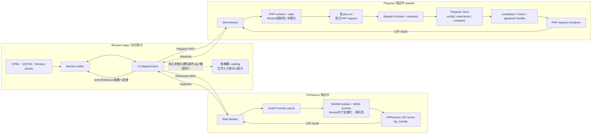
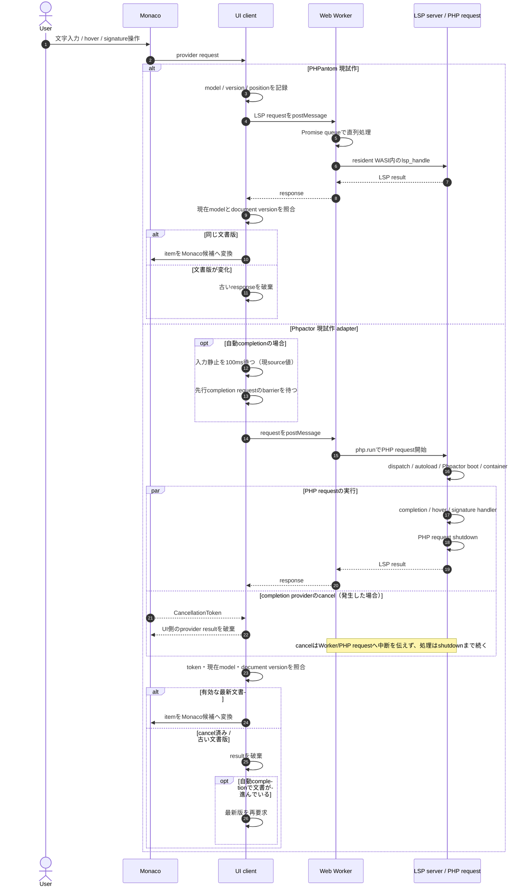

# GLA-115 両UIの一次批評

## 仕様・振る舞いの構造

PRの役割は[#421 PHPantom UI/Worker](https://github.com/glassmonkey/php-playground/pull/421)、[#424 Phpactor UI/Worker](https://github.com/glassmonkey/php-playground/pull/424)、[#425 比較・画面記録](https://github.com/glassmonkey/php-playground/pull/425)。以下は既存sourceと既存runから見える経路を層ごとに分けたもの。ここでいう`Loading`は、アプリ初回起動表示ではなく、**文字入力後に候補欄へ出るLoading**を指す。

### 現試作の構成

図は今回のadapter/Worker構成を示し、言語サーバ一般の必須設計を示すものではない。特にPhpactorの各`php.run`内でのautoload/boot/container再構築は現adapterのrequest境界で発生している。Phpactor自体が毎回bootを必要とするという意味ではない。初回ページasset・runtime準備と、入力後に候補欄へ出るLoadingも別の段階である。初回準備時間、Loadingの正確な表示条件、各段階の遅延内訳は測定・確認待ち。

### 入力後のrequest sequence

自動completionの100ms静止待ち・先行completion request待ち・文書版照合と再要求はPhpactor UI/clientの現実装値・振る舞いで、Phpactor language server固有の仕様ではない。hover/signatureもPhpactor側では同じ`php.run`のPHP request境界を通るが、自動completion専用の静止待ち・barrier・retryを全request種別へ一般化しない。UI側token cancellationは、実行中Worker/PHP処理への中断命令を意味しない。Loading indicatorは文字入力後の候補欄の表示段階として初回asset/runtime準備から分けてあるが、表示開始・消去・再表示の条件はp7回答待ち。p4のruntime根拠もmanager経由で受領後に追記する。

| 層 | PHPantom（#421） | Phpactor（#424） | 差の主な所在・根拠の境界 |
|---|---|---|---|
| 初回起動 | WorkerがPHPantom WASM runtimeを読み込み、同じWorker内で再利用する。 | WorkerがPHP runtimeを起動する。runtime起動後も、各`php.run`は別requestとして終了する。 | runtime/adapter構成の実装差。起動時間の比較値はない。 |
| 入力ごとの処理 | requestをPHPantomの`lsp_handle`へ渡し、PHPantomがraw completion itemsを返す。 | `php.run`ごとにdispatchをincludeし、`Phpactor::boot()`とconfig/extensions/container構築後にhandlerを呼び、request終了する。 | raw items・metadataは各language serverの結果。Phpactorの毎回bootは現adapterの経路で、Phpactor必須制約ではない。bootのRTT寄与は未分離。 |
| 要求queue・cancel | Worker内にPromise queueがあり、clientはrequest時のmodel/versionとresponse時の状態を照合して古い結果を破棄する。 | UI clientに100ms settle、in-flight barrier、CancellationToken、最新versionへのretryがある。UI cancel後もWorker内のrequest自体は継続し得る。 | queue/cancel/retryはadapter/UIとWorker連携の実装差。**候補欄Loadingの開始・終了条件**はp7が調査中。runtime/request内訳はp4が調査中。両回答はmanager経由で反映予定。 |
| Monaco表示 | LSP itemをMonaco suggestionへ変換し、range/insertText等を用いて表示する。raw item数とvisible row数が異なる場合がある。 | 同じくLSP itemをMonaco suggestionへ変換する。過去の`new Gre`ではraw `items: []`でも画面に5行あり、Completion OFFでも同じ表示を観測。Monaco word suggestion由来を支持するがprovider IDは未特定。 | 表示filter/変換と候補欄LoadingはUI/editor側。画面行をraw language-server候補として数えない。 |

この切り分けでは、**候補内容・metadataの差**と**起動/要求経路・queue/cancel・Loading・Monaco表示の差**を混ぜない。既存sourceは構造の根拠、trace/screenshotはそのrunでの振る舞いの根拠。実測していない段階時間やLoading内部状態は未確定のまま扱う。採用判断は付けない。

## 対象と方法

2026-10-25に、PHP 8.5をUI上で確認して測定した。対象headはPHPantom `863c1337adb05a339dbbd6eb20a9c26eb7b63316` とPhpactor `ee48f4733c802fa39fc3abd54441dd9737017ee8`。両source worktreeは測定時点でclean、対象Viteはそれぞれ7260/3471で稼働していた。隔離Playwright BrowserContext、Chrome `156.0.8078.47`、viewport 1440×1000を使用し、既存の利用者プロファイルには触れていない。

同期runはPHPantom [trace](evidence/phpantom-2026-10-25T12-30-40-981Z/trace.json)、Phpactor [最終trace](evidence/phpactor-2026-10-25T12-38-22-832Z/trace.json)。共通コードは[fixture.php](fixture.php)。各手動候補ケースは全文と`didChange` versionを確認後、カーソル末尾のpositionにCtrl+Spaceを2回送り、対応するWorker responseをrequest idで対応付けた。r1は各ケースの初回request、r2は同じ全文/versionでの再request。ページ起動・初期化待ちの時間は含めない。旧fixtureは[fixture-v1.php](fixture-v1.php)に保存した。

以前の同期漏れrunは`evidence/unsynced-20261025/`に保持しているが、今回の候補比較には使わない。Phpactorの初回PHP 8.2 runもPHP 8.5比較から除外した。Completion OFF診断は原条件と別条件であり、[PHPantom](evidence/phpantom-word-suggestions-2026-10-25T12-25-57-915Z/trace.json)と[Phpactor](evidence/phpactor-word-suggestions-2026-10-25T12-25-32-069Z/trace.json)に記録した。

## 同じ入力での観測

| 入力・操作 | PHPantom raw応答 → 画面 | Phpactor raw応答 → 画面 | 解釈・差の根拠 |
|---|---|---|---|
| `strl` + Ctrl+Space | 4件（`strlen`, `mb_strlen`, `iconv_strlen`, `grapheme_strlen`）→ 4行 | 6件（`strlen`と一般keyword 5件）→ 1行（`strlen`） | raw数と表示数は同じでない。Phpactorのkeywordはprefix filter後に非表示。両方で`strlen`詳細/引数snippetを表示。 |
| `$gre` + Ctrl+Space | `$greeter`, `$greeting` → 2行 | 同じ2件 → 2行 | local variable候補は両方で確認。Phpactorはdetailに推論型（`Greeter`/`string`）を表示、PHPantomは両方`variable`。 |
| `$greeter->` + Ctrl+Space | `message`, `create()`, `greet()` → 3行 | 同じ3項目 → 3行 | fixtureの型推論とinstance member候補を両方で確認。Phpactor detailは可視性・signatureをより明記。 |
| `Greeter::` + Ctrl+Space | `class`（`class-string`）と`create()` → 2行 | raw `class`（`insertText=class`, `detail=Greeter`, kind 21）とstatic `create()` → 2行 | 現fixtureにはstatic `create(): self`を定義。Phpactorの`class`は`::class`疑似定数であり、static methodではない。行表示の`class / Greeter`はraw label/detail。旧fixtureにstatic methodがなかったrunをstatic補完根拠にしない。 |
| `new Gre` + Ctrl+Space | raw 5件 → 画面2行（`Greeter`, `IntlGregorianCalendar`） | raw `items: []` → 画面5行（`Greeter`, `greet`, `greetUser`, `$greeter`, `$greeting`） | PHPantomはWorker候補のうち画面に2件。Phpactorの画面5行はCompletion OFFでも同じ5行、JSON-RPC 0件で再現。Monaco word suggestions由来を強く支持するがexact provider IDは未確認。5行をPhpactor LSP候補とは数えない。 |
| `greetUser(` / `strlen(` + Ctrl+Space | named argument 1件ずつ表示 | local変数とnamed parameterの2件を表示 | これはcompletion候補でありsignature helpではない。Phpactorでは同位置でも既存変数`$greeting`が混ざった。 |

### `str_`と`strl`の手動/自動追試

追加の同一fixture追試で`str_`を貼り付けてCtrl+Space、また`str`から`_`を自然入力する操作を分けた。両方の自動入力でversion一致の`textDocument/completion` requestとresponseがあり、この制御条件では`str_`候補が非表示になる現象を再現しなかった。ユーザー実試用時の入力履歴やfocusが異なれば結果は別になり得る。

| 入力 | PHPantom manual / auto | Phpactor manual / auto |
|---|---|---|
| `str_` | raw 32 / 32 → visible 13 / 13。例: `str_contains`, `str_starts_with`, `str_replace` | raw 19 / 19 → visible 12 / 12。rawには`class`, `enum`, `trait`, `function`, `interface`も含むが画面には出ない。 |
| `strl` | raw 4 / 4 → visible 4 / 4 | raw 6 / 6 → visible 1 / 1（`strlen`。5 keyword itemsは非表示） |

同じtraceの手動/自動順にrequest ID・文書version・line 7 / character 4を保存した。[PHPantom trace](evidence/phpantom-str-prefix-2026-10-25T13-35-08-284Z/trace.json)、[Phpactor trace](evidence/phpactor-str-prefix-2026-10-25T13-35-19-537Z/trace.json)。PHPantomでは`str_`の自動raw itemに`str_contains($haystack, $needle)`等のsignature labelがある一方、手動raw labelは関数名のみの候補が含まれた。画面も自動側ではdetailが見える項目があり、同じ候補集合でもmetadata/表示詳細に差があった。原因は未確定。

### Worker RTT

単位ms。各値は手動completionのrequest postMessageから対応response受信までで、候補の意味・画面反映・人の入力待ちは含まない。各2回のみで統計的な代表値ではない。

| ケース | PHPantom r1 / r2 | Phpactor r1 / r2 |
|---|---:|---:|
| `strl` | 29.2 / 5.3 | 347.4 / 237.6 |
| `$gre` | 13.5 / 3.8 | 224.5 / 162.2 |
| `$greeter->` | 24.8 / 8.7 | 227.7 / 218.0 |
| `Greeter::` | 1.5 / 5.1 | 199.3 / 214.8 |
| `new Gre` | 106.6 / 14.5 | 137.9 / 154.5 |
| `greetUser(` | 4.2 / 5.7 | 156.5 / 177.4 |
| `strlen(` | 8.6 / 3.1 | 185.2 / 197.4 |

このboundaryではPHPantomの応答が今回の全ケースで短かった。Phpactorの初期化request RTTは446.4ms、PHPantomは359.0msだった。値はこのhead・fixture・worker内の観測であり、Phpactor起動/boot時間単独の測定や一般性能値ではない。`new Gre`は返却内容も異なるので、同一仕事量の速度比較とみなさない。

別境界として、Ctrl+Space requestからDOM上の候補rowを確認した時刻までの観測値もtraceにある（ms、r1/r2）。これはWorker RTTにUI処理を足した厳密なpaint時刻ではなく、response後にrunnerがrowを検査した時刻までを含む。

| ケース | PHPantom r1 / r2 | Phpactor r1 / r2 |
|---|---:|---:|
| `strl` | 93.8 / 35.1 | 619.8 / 366.3 |
| `$gre` | 67.1 / 67.6 | 441.8 / 187.5 |
| `$greeter->` | 67.4 / 40.8 | 253.0 / 258.5 |
| `Greeter::` | 60.0 / 48.3 | 224.9 / 249.6 |
| `new Gre` | 177.3 / 91.0 | 163.9 / 239.1 |
| `greetUser(` | 59.3 / 63.5 | 218.0 / 399.4 |
| `strlen(` | 118.9 / 93.2 | 214.6 / 231.9 |

## 自動入力と画面までの体験

手動Ctrl+Spaceと実際のキー入力を分けた。PHPantomは`->`、`::`、`strl`入力後に候補表示を確認し、Worker RTTは3.3、3.4、4.2ms。修正後Phpactor runでは`->`、`::`、`strl`がすべて表示され、RTTは192.1、199.0、152.1ms。`->`の明示Ctrl+Spaceは別scenarioで227.7/218.0msだった。

旧Phpactor run `12-31-07-559Z`の`->`欠測境界も確認した。[旧スクリーンショット](evidence/phpactor-2026-10-25T12-31-07-559Z/typed-arrow-trigger.png)には全文でなく`->`だけがeditor先頭行に表示されていた。traceではpaste後の全文version 13に続き、version 14の`-`、version 15の`->`というchangeがあり、completion request id 30は`line 0, character 2`、responseは空itemsだった。期待した`line 8, character 10`ではない。したがってこの空応答をbackend候補なしと扱わない。画面はPHP 8.5、Completion checkedで、traceのpage errorは空。旧runはactive DOM focus / selected textを記録しておらず、その値は確定できないが、request positionと画像はcaretが先頭にあったことを示す。原因は貼り付け後に選択が残り、続くキーが全文を置換した入力ハーネス側の問題と考えられる。

runnerはpaste後に`Control+End`で末尾へ移動するよう修正した。修正後run [trace](evidence/phpactor-2026-10-25T12-38-22-832Z/trace.json)では、`->`入力の全文を画面editorで確認し、document version 16の変更後、requestは`line 8, character 10`、対応responseまで192.1ms、表示候補は`create`, `greet`, `message`。キー操作開始→request 202.7ms。active elementはMonaco `native-edit-context` / “Editor content”、PHP 8.5、Completion checked、page errorなし。Ctrl+Spaceの`$greeter->` 2回は自然入力とは別scenarioに記録した。この訂正は評価runnerだけで、UI/Worker実装は変更していない。

修正runnerの自然入力時刻（入力操作→request、request→response）はPHPantomが`->` 94.7+3.3ms、`::` 95.6+3.4ms、`strl` 16.4+4.2ms。Phpactorは`->` 202.7+192.1ms、`::` 199.4+203.2ms、`strl` 19.7+152.1ms。キー時刻は入力操作直前、request/responseはWorker postMessage観測。この単発runはresponse後にrowを確認するまでで、初回DOM表示は次節で別計測した。

Phpactor UI sourceには自動trigger前の100ms settle、request cancellation、completion barrierがある。下の遅延応答追試では、1.4秒保留した旧候補を文書変更後にUIへ解放したが、新しい`greet`行は維持された。連続typing中の全応答順序や settle の見た目への寄与までは測っていない。最新Phpactor runではsignature相関が有効になったlocal signature responseはnull/tooltipなし、builtin signatureはresponse/tooltipあり。

別の有効な8.5 runでは、Phpactor builtin `strlen(`のsignature help tooltipが表示され、local `greetUser(`はresponse `null`・tooltipなしだった。PHPantomでは両方tooltipが表示され、local signatureは`(string $name = 'Guest'): string`、builtinは`(string $string): int<0, max>`。

同じ8.5 fixtureの`$greeter`でpointer hoverとMac Monaco shortcut `Meta+K`, `Meta+I`を別々に実行した。両方ともrequestはline 5 / character 3。PHPantomはWorker応答8.5/8.9ms、tooltipは`<?php $greeter = Greeter`を含むcode block。Phpactorは114.6/57.6ms、Worker `contents=Greeter`、tooltip text `Greeter`。request→最初の`.monaco-hover`可視DOM mutationはPHPantom 148.3/2.4ms、Phpactor 46.4/3.4ms（pointer/keyboard順）。両方法ともDOM上`.monaco-hover`を確認し、page/console errorなし。結果はPHPantom [hover trace](evidence/phpantom-hover-2026-10-25T13-17-33-198Z/trace.json)とPhpactor [hover trace](evidence/phpactor-hover-2026-10-25T13-17-20-597Z/trace.json)。先行runnerのPhpactor `visible=false`はtooltip非表示を示す証拠ではなく、pointer位置で撮った画像にはtooltipが写り、改良計測でpointer/keyboardとも表示を確認した。旧判定を訂正する。mutation値はpaint時刻ではない。

## 挿入・操作・設定

両UIで`strl`候補をEnter選択すると`strlen($string)`がprefixを置換し、snippetの引数箇所へ移動した。Tabでplaceholderを抜けた後`;`を入力できた。`$gre`から`$greeter`を選んでも`$$greeter`にはならなかった。PHPantomは同じ候補行で`strlen($string)`と`int<0, max>`を見せ、Phpactorは`strlen`とsignature detailを表示した。結果画像は各同期runの`builtin-strl-insert.png`, `builtin-strl-tab.png`, `local-variable-insert.png`。

Completion checkboxをOFFにするとWorkerが終了し、ONで再初期化することを両方で確認。PHPantomはPHP 8.4選択時に「PHP 8.5を使用」とエラー表示し、8.5へ戻すと再初期化した。Phpactorは8.4が未検証という警告を表示し、8.5へ戻した。light/dark切替とCompletion checkbox/HTML Previewの画面上の並びを確認した。keyboard/focusの網羅的なアクセシビリティ評価はしていない。

## 追加追試: 遅延応答と初回DOM表示

応答遅延は隔離ページのWorker message capture listenerで注入した。指定methodのresponseをapp listenerへ渡す前に`stopImmediatePropagation()`で保留し、1.4秒後に同じdataのMessageEventを隔離ページ内でdispatchした。server、product Worker/sourceは変更していない。

- **入力変更後の旧completion:** 両方で`$greeter->`要求（line 7 / character 10）のresponseを1.4秒保留し、文書を`$greeter->g`へ変更してCtrl+Spaceを別requestとして実行。PHPantomは現在候補`greet()`、Phpactorは`greet`を表示。旧3-item responseを解放した後も現在候補1件が維持され、旧候補一覧に戻らなかった。[PHPantom trace](evidence/phpantom-delay-2026-10-25T13-21-21-192Z/trace.json)、[Phpactor trace](evidence/phpactor-delay-2026-10-25T13-20-55-536Z/trace.json)。2要求は別request ID / 文書versionとして記録。

OFF caseはhover応答を待つ間にcheckbox操作がWorkerをterminateした。隔離harnessは後から応答を再配送しなかったため、これは製品側のgeneration/version guardが古い応答を拒否した証拠ではない。観測できたのはWorker終了と配送なし、ON後の再initialize/didOpen、新しいhoverの成功まで。

初回表示計測は[Phpactor](evidence/phpactor-first-visible-2026-10-25T13-26-48-949Z/trace.json)と[PHPantom](evidence/phpantom-first-visible-2026-10-25T13-26-59-591Z/trace.json)で別々に実行。各アプリ/ケースはfresh BrowserContextを作り、同じ8.5 fixtureで`$greeter->`と`strl`を自然キー入力で各3回実施。r1はそのcontextの初completion request、r2/r3は同Worker内の反復。text/version/request position/response idは全有効runで一致。UIの「first DOM visible」はMutationObserver後の次animation frameに、widgetにrowがあり、rectが正、display/visibilityが有効、opacity>0となった最初のDOM/styleサンプル。physical paint完了までは保証しない。

各行の時刻は`Worker RTT / input→request / input→first DOM visible`（ms）。入力時刻はキー送信直前、RTTはWorker postMessage境界。全試行でWorker responseがDOM-visible sampleより先だった。

| UI / case | r1 first-after-init | r2 same-worker | r3 same-worker |
|---|---:|---:|---:|
| PHPantom `$greeter->` | 19.2 / 90.7 / 127.8 | 8.3 / 88.2 / 128.1 | 8.4 / 87.6 / 127.7 |
| Phpactor `$greeter->` | 201.7 / 192.8 / 413.8 | 90.2 / 189.2 / 297.5 | 84.2 / 188.4 / 280.0 |
| PHPantom `strl` | 9.7 / 15.5 / 44.1 | 2.3 / 13.7 / 45.2 | 2.1 / 14.1 / 45.9 |
| Phpactor `strl` | 182.7 / 17.5 / 213.9 | 86.6 / 14.8 / 110.9 | 71.3 / 15.9 / 89.9 |

`first-after-init` is first completion request after LSP initialize in a new context; it excludes browser/server cold start and is not a process-cold benchmark. Phpactor `->` has source-level 100ms settle before request, reflected in input→request values. These small samples compare these two heads/cases only; no statistical or product-wide performance inference follows.

## 修正後のPhpactor自然入力追試

ユーザーが「Ctrl+Spaceなしの候補表示」を必須条件にしたため、既存のPHPantom `863c1337adb05a339dbbd6eb20a9c26eb7b63316` / Phpactor `ee48f4733c802fa39fc3abd54441dd9737017ee8` 比較を維持し、修正後Phpactorだけを別runで確認した。manager READY通知とsource worktree `gla-115-lsp-phpactor-preview` のclean/headを照合したうえで、保持中の3471 serverへ隔離Chrome `156.0.8078.47` から接続した。UIはPHP 8.5、Completion ON、[fixture.php](fixture.php)。測定操作にCtrl+Spaceは使っていない。

| 自然入力 | 修正head raw response → 画面行 | 入力/応答の観測 |
|---|---|---|
| `s`→`str_`、160ms/文字 | 1.8秒時点: 最新requestなし/0行。さらに待つとlatest request 19→12 | 1.8秒停止時の[run 14-34 trace](evidence/phpactor-natural-after-fix-2026-10-25T14-34-22-926Z/str-underscore-slow-trace.json)では、version 3 / line 7 character 1への最初の`s` request id 2だけがあり、response未着、最新prefix要求なし、widget 0行。これはその時点の自動表示AC未達。別の長時間待機[run 14-35](evidence/phpactor-natural-after-fix-2026-10-25T14-35-23-888Z/str-underscore-slow-trace.json)ではその応答が3.611秒後に168 itemsを返すが、model version 6に変わっていたためsource traceは`document-version-changed-at-response`として破棄。100ms後に自動retryし、version 6 / line 7 character 4でid 3を要求、403ms後に19 items、DOM上12行を表示。input開始→latest request 3.930秒、→DOM visible 4.346秒。遅延後に回復する観測は1.8秒条件の未達を打ち消さない。 |
| `s`→`str_`、10ms/文字 | 19→12 | version 6 / line 7 character 4の要求1件。Worker RTT 502ms、input開始→request 145ms、→DOM visible 666ms。 |
| `strl`、80ms/文字 | 6→1 (`strlen`) | version 6 / line 7 character 4。Worker RTT 169ms。 |
| `$gre`、80ms/文字 | 2→2 (`$greeter`, `$greeting`) | version 6 / line 7 character 4。Worker RTT 165ms。 |
| `$greeter->`、80ms/文字 | 3→3 (`create`, `greet`, `message`) | version 12 / line 7 character 10。Worker RTT 178ms。 |
| `Greeter::`、80ms/文字 | 2→2 (`class`, `create`) | version 11 / line 7 character 9。Worker RTT 180ms。 |

### 一次選定で見る差と対応負担

- **候補本体/adapterの切り分け:** `str_`最新prefixのPhpactor raw responseは19 itemsあり、そのうち12行が表示された。1.8秒時点で表示がないrunは、最新prefix要求が候補0件を返した事実ではなく、途中の`s`要求だけが送られ、その応答もまだ届いていなかった状態。長時間runでは`s`への168 item応答をversion不一致で破棄し、最新の`str_`を再要求した。この観測はcandidate setの欠落より、UI/adapterの要求時点・in-flight stale応答処理とWorker応答時間を含む経路の遅れを示す。Worker RTT中のPhpactor boot寄与は未分離であり、言語サーバ本体の限界とは断定できない。
- **追加対応負担:** 自然入力で遅い要求を捨てた後に最新versionを再要求する機構は入っているが、160ms/文字条件では最終表示まで約4.35秒だった。1.8秒以内の表示をACとする場合、現修正headは未達。候補ranking調整の根拠はなく、入力trigger/settle・cancellation・in-flight queue/retry・遅延表示を対象に追加調整とブラウザ回帰確認が必要になる。修正範囲や作業量はまだ見積もっていない。
- **未解決:** 10ms/160ms各1回のため、入力速度境界、Worker初回/反復負荷、複数連続responseやCPU競合時の表示時間は不明。DOM visibleはphysical paintを保証しない。PHPantom新headとの再比較も行っていない。どのlatency budgetを採るかはユーザー判断。

### 報告時点のsource状態

実ブラウザ測定時のPhpactor source headは`4fd516045ee6aa958bb01c78be5cb76205537894`でclean、asset `/src/lsp/client.ts`のhashも上記traceに保存した。その後の報告時read-only確認ではbranch `gla-115-lsp-phpactor-preview` のHEADは同じだが、`src/editor.tsx`, `src/lsp/client.ts`, `src/lsp/__test__/client.spec.ts`に未commit変更、`docs/lsp/phpactor-preview/evidence/completion-quick-suggest-v8/`に未追跡証跡があった。このdirty状態のコードは今回のブラウザ評価対象ではなく、追加測定していない。PHPantom worktreeは`863c1337adb05a339dbbd6eb20a9c26eb7b63316`でclean。

low/fast `str_`結果とsource traceは[run 14-35](evidence/phpactor-natural-after-fix-2026-10-25T14-35-23-888Z/trace.json)。各case traceには全`didChange` version、completion request/response id、cursor rect、スクリーンショット、ロードscript/styleのURL/status/ETag/SHA-256を保存した。特にロードされた`/src/lsp/client.ts`はSHA-256 `dac9df3998920ccfc6ac62de3bbd781851477b7ec1a8a3ed55c07d4671e92e77`。今後の修正head再測定では、harnessが入力停止1.8秒時点と、最終request/response後の状態を別々に記録する。candidate visibleはMutationObserver後のanimation frameでwidget rowとrect/styleを確認したDOM計測であり、physical paint完了の保証ではない。ページ/console errorはなかった。

修正headのPhpactor内部traceではslow `str_`の旧応答を返却後、version不一致として破棄し、最新versionへのretryを起動していた。fast `str_`では入力中にmodel versionが進み、settle後にfinal versionを使う1 requestとなった。

### Completion / PHP version state遷移

[state transition run 14-33](evidence/phpactor-natural-state-after-fix-2026-10-25T14-33-05-103Z/completion-off-no-retry-trace.json) と [PHP version run](evidence/phpactor-natural-state-after-fix-2026-10-25T14-33-05-103Z/version-84-no-retry-85-recovery-trace.json)で別BrowserContextを使い確認した。

- `s`へのcompletion requestのWorker responseを隔離harnessで保留し、Completion OFFを操作。Worker terminationと、OFF後1.4秒間にcompletion request/didChangeが0件、widget非表示を記録した。応答はWorker終了後にharnessが再配送せずdropしたため、製品のresponse guardを検証した結果としては扱わない。ON後、editorへ戻って自然に`tr_`を入力すると、version 6 / line 7 character 4の新要求でraw 19 items、画面12行が出た。
- `str_`を表示後にPHP 8.4へ変更すると候補widgetが消え、その後1.5秒間completion requestは0件。PHP 8.5へ戻して同じfixtureへ自然入力すると、version 11 / line 7 character 4でraw 19 items、画面12行が出た。

再測定コマンドは`node scripts/lsp/ui-evaluation/measure-natural-completion.mjs phpactor <manager-confirmed-head> <manager-ready-reference>`と`node scripts/lsp/ui-evaluation/diagnose-natural-state-changes.mjs phpactor <manager-confirmed-head> <manager-ready-reference>`。第一runnerは低速`str_`(160ms/character)・高速`str_`(10ms/character)、`strl`/`$gre`/`$greeter->`/`Greeter::`(80ms/character)を自然入力し、Ctrl+Spaceを呼ばない。期待全文は[fixture.php](fixture.php)の末尾改行の後ろへ各suffixを追加した値で、traceの`fullTextExpected`に連結後の全文を保存する。今回のready headでは、貼り付け後baseline version 2、`str_`/`strl`/`$gre`は末尾version 6、`$greeter->`はversion 12、`Greeter::`はversion 11。期待positionはLSP 0-basedでslow/fast `str_`、`strl`、`$gre`がline 7 / character 4、`$greeter->`はline 7 / character 10、`Greeter::`はline 7 / character 9。次headでは実traceのversionを照合し、固定値を強制しない。第二runnerはCompletion OFF後の要求停止とPHP 8.4中の要求停止、8.5へ戻した自然要求を確認する。両runnerともmanager通知headとPhpactor source worktree clean状態が一致しなければ起動を拒否する。

これらの修正後結果は元の両UI比較表の値へ混ぜない。PHPantomの新head再測定は行っていないため、修正後の対比較ではなくPhpactor修正headの個別UI確認である。一次報告の候補比較と同じく採用判断は付けない。

## 差の原因と確度

| 要因 | 観測・source根拠 | 確度と限界 |
|---|---|---|
| 言語サーバの候補・metadata | 同期後のraw responseに候補数・detail・kind・snippetの違いがある。特に`new Gre`のPhpactor rawは空、PHPantom rawは5。Phpactorの`Greeter::`は`::class`とstatic `create`が別item。 | raw内容の事実は高。候補差がライブラリ固有かadapter/config/context由来かの帰属は未分離。 |
| 実行方式とrequest処理 | PHPantom Workerは持続WASI上で`lsp_handle`をqueue処理。Phpactor Workerは`startPHP()`後、各`php.run`でdispatch include→`Phpactor::boot()`→config/extensions/container構築→request shutdown。 | source構造は高。Phpactor worker担当によればこれは現adapterの同期方式の負担でPhpactor必須制約ではない。persistent request/containerやlight bootは未実装・未検証で、今回RTT内のboot寄与も未分離。効果や改善量は未確定。 |
| UI/client timingと変換 | Phpactor側に100ms settle、cancellation、completion barrier。rawと画面行の数が異なるケースを観測。React/Monaco frontend dependency baselineも両branchで異なる。 | source上の差は高。通常入力の体感への寄与率は中〜低。`new Gre` 5行はMonaco由来が強いがprovider ID不明。画面計時にはReact/Monaco表示処理も混ざる。 |

遅延completion入力変更caseでは隔離ページが旧responseを同じidでapp listenerへ後から再配送した後も、現在文書の候補が維持された。source上、PHPantomはcompletion response後にrequested modelがcurrentかつversion不変か確認し、hoverも同様にmodel/versionを確認する。PhpactorはcompletionでCancellationTokenと`raceCompletionCancellation`を使い、キャンセル時はprovider候補を空で返すほかresponse後もmodel/versionを確認する。hoverもmodel/version確認を持つ。ここで確認した範囲には明示的なper-request generation counterは見当たらない。これはsource構造の記述であり、OFF/terminate時のruntime配送guardとは分ける。

Phpactor host CompleteHandlerの`new Gre`もraw空だったとの担当報告があり、ブラウザWorkerだけの障害という解釈は支持されない。担当からは該当completer source位置として`WorseClassMemberCompletor.php:124`が示された。初回host command exit 255はworkspace欠落で、temporary workspaceでは成功したとの回答であり、ブラウザ機能失敗には一般化しない。

## 再現手順と証拠

1. 各対象URLを開きPHP 8.5、HTML mode、Completion ONを画面で確認する。
2. [fixture.php](fixture.php)全文を貼り付け、`strl`, `$gre`, `$greeter->`, `Greeter::`, `new Gre`, `greetUser(`, `strlen(`をそれぞれ末尾に置く。
3. 手動候補比較はCtrl+Space。自動trigger比較は末尾に実キーで`->`, `::`, `l`を入力し、両操作の候補と時系列を混ぜない。
4. raw itemsはtrace内のrequest IDに一致するWorker response、画面行は同runの`*.png`で確認する。
5. `new Gre`のword suggestion診断だけは別contextでCompletion OFFの状態を保ち、Ctrl+Space後に行とJSON-RPC数を記録する。これは原条件の候補数に足さない。

traceには全postMessageとtimestamp、response、文書version、位置、raw items、表示行を保存した。無効な旧runも消さず、`unsynced-20261025`に根拠とともに残した。

## 未確認と小さな追加実験案

- 今回は入力変更後のold completionを一度ずつ解放して現候補が維持されることを観測した。さらに遅い/逆順の複数response列、PHP 8.4切替時の保留response、HTML Preview unmount等は未測定。Completion OFF後のhover responseは製品guardを通す試験になっていない。
- Word suggestion exact provider IDは未確認。Completion OFF時も同じ行/JSON-RPC 0で再現したためMonaco側由来は強く支持するが、provider内部IDの帰属はこの隔離測定からは分からない。
- Phpactorのlocal `greetUser(` signature helpは全文/version/positionが相関したresponse `null` とtooltipなしを確認した。これがserver feature limitかadapter/runtime差かは特定していない。
- 初期化やCPU競合を揃えた多数回の統計、各内部処理段階の時間、Worker queue待ち、Phpactor boot単独時間は測っていない。2回値から性能一般やboot改善効果を推定しない。
- Completion OFFの診断からMonaco word providerまでは強く支持されるが、exact provider IDはinstrumentしていない。

この資料は候補比較、操作感、計測境界の判断材料であり、総合点・優勝者・採用判断を付けない。

### 確認できた範囲

両UIの隔離ブラウザ操作、同期後のraw completion responseと表示行、Worker RTTとDOM-visible時刻（各代表ケース3試行）、pointer/keyboard hover、遅延response後の候補維持とcheckbox再初期化、挿入/snippet、version/themeを確認した。source読みはruntime/UI差の根拠整理に用いた。

### 反省点

初期runではdocument change race、Phpactor version/caret誤認、hover event待ち漏れ、delay injectionのcase相関漏れ、first-visible反復の古いchange再利用があった。いずれも修正runを別保存し、無効な測定値は比較から除外した。無効runも原因説明用に保持した。

### 次に活かすこと

再測定では見た目だけでケースを対応付けず、全文/version/position/request IDを結ぶ。Worker RTTと入力から表示までの時間を別々に記録し、raw候補、Monaco filter後の行、Monaco補助候補を区別する。実装構造から未測定の高速化効果を断定しない。

### WIP UI snapshot（比較runから分離）

managerの#424 GitHub readback後、PHPantom `863c1337...` とPhpactor WIP head `3e9f56893ea5373b456b8fa12ede89fdc4b37776` をagent-browser `0.39.1`の隔離sessionで各1回開き、PHP 8.5 / Completion ON / 共通fixture末尾への自然`str_`入力後の画面を保存した。両方でSuggest widgetが見え、Phpactorでは選択候補のsignature detailも画面に出た。詳細trace・性能値・候補件数を取る比較runではなく、安定性や1.8秒ACの再判定に使わない。入力手順、head/asset識別、失敗setupの除外、スクリーンショットと未確認範囲は[WIP snapshot記録](evidence/wip-snapshot-2026-10-25T15-20-51Z/README.md)を参照。
